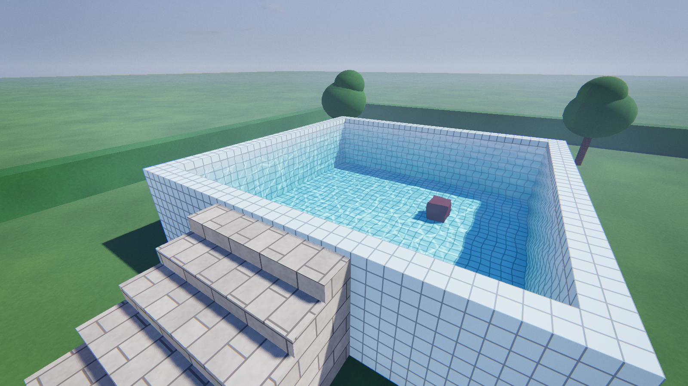

# GameKit Demo

A stand-alone Godot 4 (C#) project with a playable showcase of every GameKit module. You can walk
through it, read the signs, and copy any part into your own game.


| | |
| --- | --- |
|  |  |
|  | |

## Run it

1. Download the engine: the **mono** editor from the
   [latest Godot NVIDIA + PhysX release](https://github.com/Diginaat/godot/releases/latest)
   (`godot_4.8-nvidia-rt-dlss-physx_<version>-editor_windows_amd64_mono.zip`). This demo was made with
   [v0.7.3](https://github.com/Diginaat/godot/releases/tag/godot4.8-dev-nvidia-rt-dlss-physx-v0.7.3).
   You need the mono (C#) build, and the water module needs its PhysX engine. Stock Godot will not work.
2. Unzip it, start the editor, and import this folder (`project.godot`).
3. Press **Build**, then **F5**. The main scene is `addons/gamekit_demo/scenes/gamekit_demo.tscn`.

For exported games, install the matching `export_templates_windows_amd64_mono.tpz` from the same
release (Editor > Manage Export Templates > Install from File).

From a terminal, with the editor unzipped next to this folder:

```
dotnet build
<path-to-editor>\godot.windows.editor.x86_64.mono.exe --path .
```

## What is inside

- `addons/gamekit_*`: the GameKit modules, copied from the `GameClient` project.
- `addons/gamekit_demo`: the demo map, one scene per feature station, ready-made materials and the
  demo HUD. See [its README](addons/gamekit_demo/README.md) to use and change it.

## Add it to your project

See [addons/gamekit_demo/README.md](addons/gamekit_demo/README.md#use-it-in-your-project). In short:
copy `addons/gamekit_*`, merge four `project.godot` sections, build, and open the demo scene.

## Keeping the modules up to date

The modules here are a copy. After changing them in `GameClient`, copy the `addons/gamekit_*` folders
again. Copy every module except `gamekit_demo`, which only lives here.
